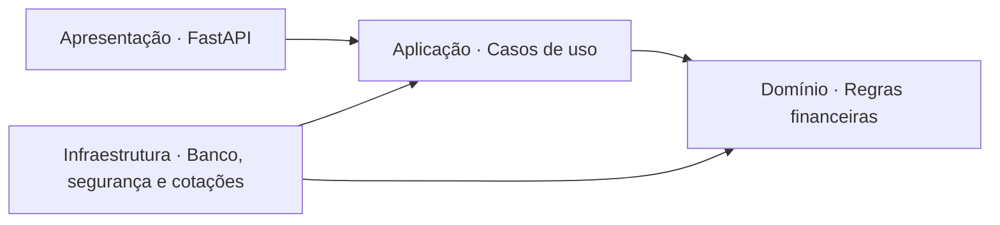

# CotaFlow API

**Acompanhe posições, custo e valor de mercado de uma carteira de ações e FIIs.**

API REST em Python para registrar compras e vendas de ativos brasileiros, reconstruir posições a partir do histórico e avaliar a carteira com cotações da brapi. Cada usuário possui uma carteira em BRL, com acesso autenticado aos próprios dados.

**Demonstração no Render:** [Swagger UI](https://cotaflow-api.onrender.com/docs) · [OpenAPI](https://cotaflow-api.onrender.com/openapi.json) · [Healthcheck](https://cotaflow-api.onrender.com/health)

[Funcionalidades](#funcionalidades) · [Exemplo](#um-exemplo-prático) · [Arquitetura](#arquitetura) · [Tecnologias](#tecnologias) · [Escopo](#escopo-e-evolução)

## Funcionalidades

- **Autenticação:** cadastro e login com JWT e senhas protegidas por Argon2.
- **Catálogo de ativos:** cadastro e consulta de ações e fundos imobiliários.
- **Registro de operações:** compras e vendas com quantidade, preço e data preservados.
- **Posições consolidadas:** quantidade disponível, preço médio e custo das posições abertas.
- **Avaliação de mercado:** cotações automáticas, resultado não realizado e variação sobre o custo.
- **Histórico por usuário:** consultas paginadas e validação do saldo em toda a sequência de operações, inclusive retroativas.

O fluxo principal é **cadastro → login → ativo → compra → posições → avaliação → venda → histórico**. Os contratos HTTP e exemplos de resposta estão disponíveis no [Swagger público](https://cotaflow-api.onrender.com/docs).

## Um exemplo prático

Duas compras de **10 unidades a R$ 30** e **10 a R$ 40**, seguidas de uma venda de **5 unidades**, deixam a seguinte posição. Com uma cotação ilustrativa de **R$ 42**:

| Quantidade | Preço médio | Custo aberto | Valor de mercado | Resultado não realizado |
| ---: | ---: | ---: | ---: | ---: |
| 15 | R$ 35,00 | R$ 525,00 | R$ 630,00 | +R$ 105,00 (+20%) |

O preço de venda permanece no histórico e não compõe o resultado não realizado da posição restante.

## Arquitetura

As responsabilidades seguem Clean Architecture. O domínio concentra as regras financeiras; a aplicação coordena os casos de uso; os adaptadores implementam persistência, segurança e acesso ao mercado.

As setas representam dependências de código. A composição em [main.py](main.py) conecta as implementações aos contratos da aplicação.

Decisões centrais:

- **Precisão financeira:** cálculos com `Decimal` e valores financeiros como strings no JSON.
- **Consistência das operações:** transação de banco e bloqueio por usuário durante a validação e gravação de compras/vendas.
- **Independência das cotações:** conexão de banco liberada antes da consulta externa; histórico e posições a custo disponíveis mesmo quando o provedor falha.
- **Avaliação completa:** cache de 30 minutos por ticker e erro explícito quando falta uma cotação, sem apresentar um total parcial como valor da carteira.

A validação do projeto inclui testes de domínio, contratos HTTP e integração com PostgreSQL para constraints, rollback, isolamento de usuários e concorrência.

## Tecnologias

| Área | Tecnologias |
| --- | --- |
| Linguagem e API | Python 3.13, FastAPI, Pydantic |
| Persistência | PostgreSQL, SQLAlchemy, Psycopg, Alembic |
| Segurança e mercado | PyJWT, pwdlib/Argon2, HTTPX2, brapi |
| Qualidade e ambiente | uv, pytest, Ruff, Docker Compose |
| Entrega | Docker, GitHub Actions, Render |

## Escopo e evolução

O recorte atual contempla ativos brasileiros em BRL e uma carteira por usuário. O catálogo é compartilhado; operações, posições e avaliações pertencem ao usuário autenticado. A API registra operações informadas pelo usuário, sem executar ordens em corretora.

**Etapa atual:** primeira versão implementada, com autenticação, catálogo, histórico, posições e avaliação. **Próximo passo:** concluir a validação integrada da versão publicada.

Integrações com corretoras, dividendos, tributação, resultado realizado e edição/exclusão de operações ficam fora desta versão. Cotações podem ter atraso e dependem da cobertura da conta brapi.
